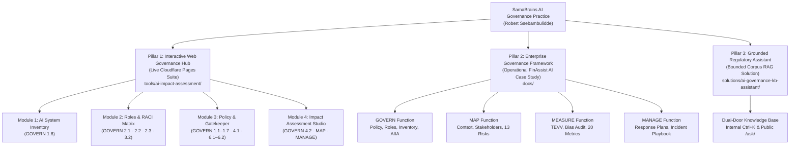
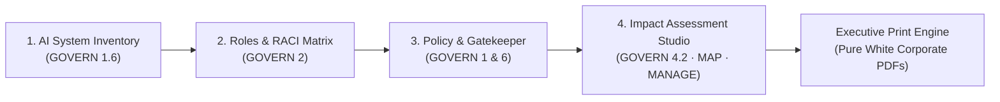

# SamaBrains AI Governance & Risk Solutions

[](https://www.nist.gov/itl/ai-risk-management-framework)
[](https://ai-impact-assessment-20y.pages.dev)
[]()
[](https://samabrains.com/)

> **Audit-ready AI governance frameworks, quantitative TEVV evaluations, and interactive operational tools.**  
> Dedicated exclusively to operationalizing the **NIST AI Risk Management Framework 1.0 (NIST AI RMF 1.0 — NIST AI 100-1)** across enterprise AI lifecycles.  
> Built at and for **[SamaBrains](https://samabrains.com/)**, an independent AI governance, safety, and security advisory practice led by **Robert Ssebambulidde**.

---

## Executive Architecture & Workspace Map

This unified repository bridges the gap between high-level regulatory frameworks and real-world engineering operations. It consists of three tightly coupled, production-ready pillars:



---

## Workspace Directory Structure

```
ai-governance/
├── README.md                                  <- Master Workspace Overview & Technical Index
├── docs/                                      <- Operational NIST AI RMF Governance Deliverables
│   ├── README.md                              <- FinAssist AI Governance Framework Overview
│   ├── 00-references/                         <- Primary Standards, Study Notes & Playbook Spreadsheets
│   │   ├── NIST-AI-RMF-Learning-Guide.md      <- 40+ page breakdown of NIST AI 100-1
│   │   ├── NIST-AI-RMF-Playbook-Study-Notes.md<- Deep dive across all 72 NIST subcategories
│   │   ├── ai-risk-guide.md                   <- AI risk, vulnerability, and mitigation guide
│   │   ├── NIST.AI.100-1.pdf                  <- Official NIST AI RMF publication
│   │   ├── AI-RMF-Playbook.pdf                <- Official NIST AI RMF Playbook publication
│   │   ├── nist-ai-rmf-playbook.csv           <- Playbook action catalog (CSV)
│   │   └── nist-ai-rmf-playbook.xlsx          <- Playbook action catalog (Excel)
│   ├── 01-govern/                             <- Institutional Governance & Accountability
│   │   ├── AI-Governance-Policy.md            <- Enterprise policy charter & oversight gates
│   │   ├── AI-Roles-Matrix.md                 <- 4-tier RACI matrix & binding veto authority
│   │   ├── AI-System-Inventory.csv            <- Central model inventory & risk classification
│   │   └── AI-Impact-Assessment-Template.md   <- Pre-deployment rights & harm assessment template
│   ├── 02-map/                                <- Context Profiling & Harm Categorization
│   │   ├── MAP-AI-System-Context-Report.md    <- Operational envelopes & 13 profiled risks (R-01..R-13)
│   │   ├── MAP-Stakeholder-Analysis.md        <- Impacted populations & grievance channels
│   │   └── MAP-Risk-Benefit-Matrix.csv        <- Risk vs. utility pre/post mitigation scoring
│   ├── 03-measure/                            <- TEVV, Bias Testing & Quantitative Metrics
│   │   ├── MEASURE-TEVV-Metrics-Framework.md  <- Independent testing & validation protocols
│   │   ├── MEASURE-Bias-Testing-Methodology.md<- Demographic parity & disparate impact testing
│   │   └── MEASURE-Metrics-Tracker.csv        <- 20 operational metrics with breach thresholds
│   └── 04-manage/                             <- Risk Mitigation, Incidents & Continuous Improvement
│       ├── MANAGE-Risk-Response-Plan.md       <- Mitigations across all 13 MAP risks
│       ├── MANAGE-Incident-Response-Playbook.md<- SEV-1 to SEV-4 classification & 15-min containment
│       ├── MANAGE-Continuous-Improvement-Log.csv<- Retraining triggers & feedback closed-loop tracking
│       └── AI-Incident-Log.md                 <- Standardized incident reporting register
├── solutions/                                 <- Practical AI Governance Architectures
│   └── ai-governance-kb-assistant/            <- Grounded Regulatory Knowledge Base & Assistant
│       └── README.md                          <- Dual-door RAG architecture & evaluation case study
└── tools/                                     <- Live Production Web Applications
    └── ai-impact-assessment/                  <- SamaBrains NIST AI Governance Hub
        ├── index.html                         <- Main 4-module portal application markup
        ├── styles.css                         <- Glassmorphism theme & light-theme print engine
        ├── app.js                             <- Interactive state engine, gatekeeper & router
        ├── inventory-data.js                  <- Seed dataset for 6 enterprise AI systems
        ├── roles-data.js                      <- 28 RACI activities, 18 roles & training data
        ├── policy-data.js                     <- 4 deployment gates, 8 principles & 9 artifacts
        ├── finassist-data.js                  <- Preloaded FinAssist AI impact assessment dataset
        ├── _headers                           <- Cloudflare security & cache-invalidation headers
        └── README.md                          <- Web suite user documentation & deployment guide
```

---

## Pillar 1: Interactive NIST AI RMF Governance Hub (Cloudflare Pages)

> **Live Production Web Application:** [https://ai-impact-assessment-20y.pages.dev](https://ai-impact-assessment-20y.pages.dev)  
> **Source Directory:** [`tools/ai-impact-assessment/`](tools/ai-impact-assessment/)  
> **Infrastructure:** Turnkey static edge deployment on Cloudflare Pages (Zero server backend, zero tracking, pure client-side cryptographic and local storage persistence).

The **SamaBrains NIST AI Governance Hub** operationalizes the NIST AI Risk Management Framework into four synchronized, interactive modules:



### Module 1: AI System Inventory & Registry (GOVERN 1.6)
* **Direct Link:** [https://ai-impact-assessment-20y.pages.dev/#inventory](https://ai-impact-assessment-20y.pages.dev/#inventory)
* **Real-Time Model Registry:** Searchable and filterable registry tracking model classes, task types, risk tiers, third-party foundation models, data classifications, and lifecycle states.
* **Executive KPI Cards:** Live indicators for total registered systems, critical/high-risk count, active production deployments, and assurance review readiness.
* **Two-Way CSV Synchronization:** Seamless export and import fully compatible with [`docs/01-govern/AI-System-Inventory.csv`](docs/01-govern/AI-System-Inventory.csv).
* **One-Click AIIA Launch:** Instantly transitions any inventory system into the Impact Assessment Studio with pre-bound identification metadata.
* **Executive Registry PDF:** Pure white A4 printable registry report for board review and compliance audits.

### Module 2: AI Roles & Responsibilities Matrix (GOVERN 2.1 · 2.2 · 2.3 · 3.2)
* **Direct Link:** [https://ai-impact-assessment-20y.pages.dev/#roles](https://ai-impact-assessment-20y.pages.dev/#roles)
* **Interactive RACI Lifecycle Matrix:** 28 governance activities across 6 phases (Governance & Policy, Conception & Design, Deployment & Release, Monitoring & TEVV, Incident Response, Decommissioning) mapped against 18 enterprise roles with instant role-highlighting and text search.
* **Role Catalog & Veto Authority Directory:** Complete directory of 18 roles across 4 tiers (Governance & Leadership, Project Delivery, Operational Oversight, External Advisory) documenting reporting lines, responsibilities, and hard veto authorities.
* **Human-AI Oversight Configuration Register (GOVERN 3.2):** Explicit human-in-the-loop (HITL), human-on-the-loop (HOTL), and human-in-command (HIC) operational boundaries tied to inventory systems (`AI-001` through `AI-006`).
* **Workforce Competency Tracker (GOVERN 2.2):** Role-based training records tracking compliance across 6 core AI risk domains.
* **Dedicated RACI Exporter:** One-click RACI CSV download and executive white-paper print view.

### Module 3: AI Governance Policy & Deployment Gatekeeper (GOVERN 1.1–1.7 · 4.1 · 6.1–6.2)
* **Direct Link:** [https://ai-impact-assessment-20y.pages.dev/#policy](https://ai-impact-assessment-20y.pages.dev/#policy)
* **Live 4-Tier Go/No-Go Gatekeeper (GOVERN 1.3):** Interactive gate validator evaluating any selected system against the 4 non-negotiable policy release criteria:
  1. *Zero Unmitigated Critical Risks Gate (GATE-01)*
  2. *Legal & Regulatory Compliance Sign-off Gate (GATE-02)*
  3. *Independent TEVV Validation Dossier Gate (GATE-03)*
  4. *Executive Governance & Veto Sign-Off Gate (GATE-04)*
* **Real-Time Clearance Status:** Evaluates systems dynamically with live status badging (`CLEARED FOR DEPLOYMENT`, `CONDITIONAL HOLD`, `BLOCKED (GATE FAILURE)`).
* **Trustworthy AI Principles Audit (GOVERN 1.2):** Verification checklist across all 8 core principles (Accountability, Transparency, Fairness, Safety, Privacy, Security, Reliability, Explainability).
* **Mandatory Lifecycle Documentation Standards (GOVERN 1.4):** Real-time readiness matrix tracking all 9 required governance artifacts per system.
* **Decommissioning Triggers (GOVERN 1.7):** 5 standard triggers requiring immediate system suspension, human failover, or retirement.
* **Third-Party AI & Supply Chain Screener (GOVERN 6.1 & 6.2):** Foundation model due diligence evaluating licensing, data retention SLAs, uptime, and adversarial red-teaming.
* **Formal Policy Exceptions & Waivers Register (GOVERN 1.1):** Active deviation tracker with expiry countdowns, compensating controls, and approving officers.
* **Executive Policy Attestation PDF:** One-click generation of the formal Policy Attestation Statement in audit-ready white-paper PDF and Markdown.

### Module 4: AI Impact Assessment Studio (GOVERN 4.2 · MAP 3.1 · MANAGE 1.1)
* **Direct Link:** [https://ai-impact-assessment-20y.pages.dev/#assessment](https://ai-impact-assessment-20y.pages.dev/#assessment)
* **10-Part Wizard:** Comprehensive assessment guiding teams through identification, operational context, trustworthy alignment, legal thresholds, benefits, harms, mitigations, consultations, TEVV summary, and deployment sign-offs.
* **Interactive Risk Calculator:** Real-time Likelihood (1–5) $\times$ Impact (1–5) calculation with dynamic risk badges (Low, Medium, High, Critical) and risk scorecard heat counter.
* **Preset Switcher:** Instant *"Load FinAssist AI Example"* for demonstration and benchmarking, or *"New Blank"* for net-new assessments.
* **Multi-Format Export Engine:** High-design executive PDF with digital signature stamps, audit-ready Markdown download, and full JSON state backup.

---

## Pillar 2: Enterprise AI Governance Framework & TEVV Case Study (FinAssist AI)

> **Full Operational Case Study:** [`docs/README.md`](docs/README.md)  
> **Domain:** Commercial Retail Banking / Generative AI Customer Assistant (`SYS-FIN-001`)  
> **Framework:** NIST AI Risk Management Framework 1.0 (NIST AI 100-1)

Most AI governance initiatives remain confined to abstract principles. This framework represents a **field-tested, audit-ready operational implementation** detailing line-item organizational and technical controls across all four NIST AI RMF functions:

### 1. GOVERN Function Deliverables
* [AI-Governance-Policy.md](docs/01-govern/AI-Governance-Policy.md): Enterprise policy establishing principles, 4 Go/No-Go gates, third-party model standards, and review cadences.
* [AI-Roles-Matrix.md](docs/01-govern/AI-Roles-Matrix.md): 4-tier RACI matrix across 18 roles detailing binding veto rights for Ethics, Legal, and Risk officers.
* [AI-System-Inventory.csv](docs/01-govern/AI-System-Inventory.csv): Standardized model inventory tracking 20 attributes per AI asset.
* [AI-Impact-Assessment-Template.md](docs/01-govern/AI-Impact-Assessment-Template.md): 10-section pre-deployment assessment covering civil rights, privacy, failure modes, and human agency.

### 2. MAP Function Deliverables
* [MAP-AI-System-Context-Report.md](docs/02-map/MAP-AI-System-Context-Report.md): Technical boundaries, non-AI alternatives, and deep-dive risk profiles for **13 distinct harm scenarios (`R-01` to `R-13`)**.
* [MAP-Stakeholder-Analysis.md](docs/02-map/MAP-Stakeholder-Analysis.md): Systematic analysis of vulnerable groups, frontline operators, and community grievance mechanisms.
* [MAP-Risk-Benefit-Matrix.csv](docs/02-map/MAP-Risk-Benefit-Matrix.csv): Quantitative risk vs. utility scoring balancing speed against potential harms.

### 3. MEASURE Function Deliverables
* [MEASURE-TEVV-Metrics-Framework.md](docs/03-measure/MEASURE-TEVV-Metrics-Framework.md): Independent TEVV testing protocols covering trustworthiness, robustness, and safety.
* [MEASURE-Bias-Testing-Methodology.md](docs/03-measure/MEASURE-Bias-Testing-Methodology.md): Statistical testing methodologies for disparate impact ratios ($0.80–1.25$ threshold) and counterfactual evaluations.
* [MEASURE-Metrics-Tracker.csv](docs/03-measure/MEASURE-Metrics-Tracker.csv): **20 quantitative production metrics (`M-01` to `M-20`)** with hard breach thresholds, evaluation cadences, and assigned owners:
  * *Hallucination Rate (M-01):* Target $<1.0\%$, Breach threshold $>2.0\%$.
  * *Prompt Injection Bypass Rate (M-02):* Target $0.0\%$, Breach threshold $>1.0\%$.
  * *Disparate Impact Ratio (M-03):* Target $0.90–1.10$, Breach threshold $<0.80$ or $>1.25$.
  * *P95 Inference Latency (M-05):* Target $<1200\text{ms}$, Breach threshold $>1800\text{ms}$.

### 4. MANAGE Function Deliverables
* [MANAGE-Risk-Response-Plan.md](docs/04-manage/MANAGE-Risk-Response-Plan.md): Actionable response strategies and residual risk acceptances for all 13 mapped risks.
* [MANAGE-Incident-Response-Playbook.md](docs/04-manage/MANAGE-Incident-Response-Playbook.md): Operational incident handling classifying `SEV-1` through `SEV-4` events with a mandatory **15-minute containment SLA**.
* [MANAGE-Continuous-Improvement-Log.csv](docs/04-manage/MANAGE-Continuous-Improvement-Log.csv): Closed-loop log linking monitoring alerts and post-mortems to model retraining.
* [AI-Incident-Log.md](docs/04-manage/AI-Incident-Log.md): Standardized incident reporting register with root-cause analysis templates.

---

## Pillar 3: Grounded Regulatory Knowledge Base & Assistant

> **Solution Write-up:** [`solutions/ai-governance-kb-assistant/README.md`](solutions/ai-governance-kb-assistant/README.md)  
> **Live Advisory Demo:** [https://samabrains.com/ask/](https://samabrains.com/ask/)

A production RAG solution demonstrating how enterprises can deliver **instant, cited answers** over bounded, authoritative AI governance corpora:

* **Bounded Corpus Grounding:** Queries are indexed exclusively against official regulatory publications (NIST AI RMF 1.0, Uganda Data Protection and Privacy Act 2019, SamaBrains advisory playbooks), preventing unbounded hallucinations.
* **Dual-Door Access Architecture:**
  1. *Internal Staff Knowledge Base (`Ctrl+K`):* Rapid regulatory clause lookup during risk assessments.
  2. *Public Advisory Assistant (`/ask/`):* Transparent, source-attributed answers for enterprise clients.
* **Strict Source Attribution:** Every response includes direct document citations and paragraph-level references.

---

## Enterprise AI GRC & Observability Integration

This repository's deliverables are structured for direct ingestion into modern AI GRC and telemetry platforms:

| Platform Category | Target Platforms | Direct Integration Mapping |
|---|---|---|
| **AI GRC Platforms** | [VerifyWise.ai](https://verifywise.ai/) · Credo AI · Holistic AI | Ingests [`AI-System-Inventory.csv`](docs/01-govern/AI-System-Inventory.csv), [`AI-Roles-Matrix.md`](docs/01-govern/AI-Roles-Matrix.md), and [`AI-Governance-Policy.md`](docs/01-govern/AI-Governance-Policy.md) into automated compliance registers. |
| **Enterprise Compliance** | Vanta AI · OneTrust · ServiceNow GRC | Ingests deployment gate records and formal executive attestations as audit evidence. |
| **LLM Observability** | Langfuse · Arize Phoenix · OpenTelemetry | Real-time production telemetry feeds into the 20 line-item metrics in [`MEASURE-Metrics-Tracker.csv`](docs/03-measure/MEASURE-Metrics-Tracker.csv). |

---

## Deployment & Local Development

### Deploying the Web Suite to Cloudflare Pages

The web application requires zero external build steps or server runtime. It can be deployed in under 2 minutes:

#### Method A: Direct Upload via Wrangler CLI
```powershell
# Authenticate and deploy directly to Cloudflare Pages
$env:CLOUDFLARE_ACCOUNT_ID="d77cecb6dcb60741b68f2f1f59f897d2"
npx wrangler pages deploy tools/ai-impact-assessment --project-name="ai-impact-assessment" --branch="main"
```

#### Method B: Cloudflare Git Integration
1. Log into your **[Cloudflare Dashboard](https://dash.cloudflare.com/)** → **Workers & Pages** → **Create application** → **Pages** → **Connect to Git**.
2. Select repository: `rssebambulidde/ai-governance`.
3. Set **Build output directory:** `tools/ai-impact-assessment` (leave Build command empty).
4. Click **Save and Deploy**.

### Running Locally

```powershell
# Using Python
python -m http.server 8080 --directory tools/ai-impact-assessment

# Or using npx serve
npx serve tools/ai-impact-assessment
```
Open `http://localhost:8080` in your browser.

---

## Governance & Engineering Quality Commitments

* **Framework Purity:** Strictly aligned with **NIST AI Risk Management Framework 1.0 (NIST AI RMF 1.0 — NIST AI 100-1)**.
* **Temporal Integrity:** All dates across policies, models, and records are standardized to **2026**.
* **Print Engine Resilience:** Dedicated `@media print` engine forcing pure white canvases, crisp dark typography, and formal signature stamps, eliminating dark mode color inversion or black PDF prints.
* **Navigation Architecture:** Full browser hash routing (`#inventory`, `#roles`, `#policy`, `#assessment`) allowing persistent module linking and deep-link bookmarks.
* **Repository Hygiene:** All files use consistent `kebab-case` naming with zero underscores and clean heading hierarchies.

---

## Author & Practice Contact

* **Practice Lead:** Robert Ssebambulidde
* **Practice:** [SamaBrains AI Governance & Security](https://samabrains.com/)
* **Repository:** [https://github.com/rssebambulidde/ai-governance](https://github.com/rssebambulidde/ai-governance)
* **Live Web Suite:** [https://ai-impact-assessment-20y.pages.dev](https://ai-impact-assessment-20y.pages.dev)
