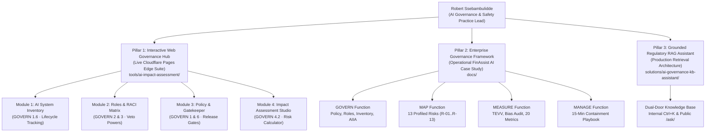

# AI Governance & Safety Engineering Portfolio

[](https://www.nist.gov/itl/ai-risk-management-framework)
[](https://ai-impact-assessment-20y.pages.dev)
[]()
[](https://samabrains.com/)

> **Executive AI Governance Portfolio of Robert Ssebambulidde**  
> *Founder & AI Governance Practice Lead at [SamaBrains](https://samabrains.com/)*  
> **Demonstrated Disciplines:** AI Risk Architecture · Algorithmic Auditing & TEVV · Policy Operationalization · Human-AI Interaction Design · Grounded RAG Systems  
> **Primary Standard:** NIST AI Risk Management Framework 1.0 (NIST AI 100-1 — GOVERN · MAP · MEASURE · MANAGE)  
> **Live Production Suite:** [https://ai-impact-assessment-20y.pages.dev](https://ai-impact-assessment-20y.pages.dev)

---

## Executive Summary for Hiring Teams & Governance Leaders

Most enterprise AI governance initiatives fail at the translation layer:
* **Legal and compliance teams** draft high-level principles that lack technical enforcement mechanisms.
* **Engineering and data science teams** optimize for benchmark accuracy while blind to demographic bias, failure cascades, and post-deployment accountability.

This repository demonstrates the ability to bridge that divide. It provides a complete, audit-ready operationalization of the **NIST AI Risk Management Framework 1.0 (NIST AI 100-1)**, progressing from boardroom oversight charters down to quantitative metric breach triggers, statistical bias testing code, emergency containment SLAs, and a live web governance hub.



---

## Core Competencies & Demonstrated Skills Matrix

This portfolio provides tangible, code- and document-level proof of competencies across the full AI lifecycle:

| Governance Competency | Demonstrated Capability | Key Repository Deliverables |
|---|---|---|
| **Institutional Policy & Release Gating** | Architecting enterprise policy charters, 4 mandatory Go/No-Go release gates (`GATE-01` to `GATE-04`), third-party foundation model screening, and policy exception registers. | [`AI-Governance-Policy.md`](docs/01-govern/AI-Governance-Policy.md)<br>[Policy & Gatekeeper Web Module](https://ai-impact-assessment-20y.pages.dev/#policy) |
| **Accountability & Veto Structuring** | Establishing 4-tier RACI structures across 18 enterprise roles, formalizing binding veto authorities for Ethics/Legal officers, and defining operational HITL/HOTL/HIC boundaries. | [`AI-Roles-Matrix.md`](docs/01-govern/AI-Roles-Matrix.md)<br>[Roles & RACI Web Module](https://ai-impact-assessment-20y.pages.dev/#roles) |
| **Socio-Technical Risk Profiling** | Contextualizing AI deployment boundaries, mapping disparate impact on vulnerable customer populations, and analyzing 13 distinct socio-technical failure modes (`R-01` to `R-13`). | [`MAP-AI-System-Context-Report.md`](docs/02-map/MAP-AI-System-Context-Report.md)<br>[`MAP-Stakeholder-Analysis.md`](docs/02-map/MAP-Stakeholder-Analysis.md) |
| **TEVV & Algorithmic Bias Auditing** | Formulating empirical testing protocols, disparate impact ratio evaluation ($0.80–1.25$), counterfactual fairness testing, and 20 line-item quantitative metrics with hard breach thresholds. | [`MEASURE-Bias-Testing-Methodology.md`](docs/03-measure/MEASURE-Bias-Testing-Methodology.md)<br>[`MEASURE-Metrics-Tracker.csv`](docs/03-measure/MEASURE-Metrics-Tracker.csv) |
| **Incident Response & Safety Engineering** | Designing SEV-1 to SEV-4 incident escalation matrix, emergency human-failover triggers, 15-minute containment SLAs, and continuous retraining feedback loops. | [`MANAGE-Incident-Response-Playbook.md`](docs/04-manage/MANAGE-Incident-Response-Playbook.md)<br>[`AI-Incident-Log.md`](docs/04-manage/AI-Incident-Log.md) |
| **Full-Stack Governance Tooling** | Developing high-performance, turnkey client-side web applications with live state management, two-way CSV synchronizers, dynamic risk calculators, and executive PDF print engines. | [`tools/ai-impact-assessment/`](tools/ai-impact-assessment/)<br>[Live Cloudflare Pages Hub](https://ai-impact-assessment-20y.pages.dev) |
| **Grounded Retrieval-Augmented Generation (RAG)** | Designing bounded-corpus RAG systems over regulatory texts, dual-door access routing (internal vs. public), query rewrites, and strict source attribution without hallucination. | [`solutions/ai-governance-kb-assistant/`](solutions/ai-governance-kb-assistant/)<br>[Live Assistant Demo](https://samabrains.com/ask/) |

---

## Live Interactive Demonstrations (Click to Evaluate)

Recruiters and hiring managers can directly test the production systems developed in this portfolio:

* **[Live 4-Module AI Governance Hub](https://ai-impact-assessment-20y.pages.dev):**
  * **[AI System Inventory & Registry](https://ai-impact-assessment-20y.pages.dev/#inventory):** Real-time tracking of 6 enterprise AI systems, risk tiers, and two-way CSV synchronization.
  * **[Roles & RACI Lifecycle Matrix](https://ai-impact-assessment-20y.pages.dev/#roles):** 28 governance activities mapped against 18 roles, binding veto rights, and human-in-the-loop oversight modes.
  * **[Policy & Deployment Gatekeeper](https://ai-impact-assessment-20y.pages.dev/#policy):** Dynamic Go/No-Go gate evaluation toggling between approved systems (`AI-001`) and blocked systems (`AI-004`).
  * **[Impact Assessment Studio](https://ai-impact-assessment-20y.pages.dev/#assessment):** 10-part assessment wizard with real-time Likelihood $\times$ Impact risk matrix, preloaded FinAssist data, and audit-ready PDF generation.
* **[Live Grounded Regulatory Assistant](https://samabrains.com/ask/):**
  * Bounded query retrieval answering questions on NIST AI RMF 1.0, data privacy regulations, and risk controls with exact paragraph-level citations.

---

## Pillar 1: Full-Stack Web Governance Suite (Cloudflare Pages)

> **Live Deployment:** [https://ai-impact-assessment-20y.pages.dev](https://ai-impact-assessment-20y.pages.dev)  
> **Source Directory:** [`tools/ai-impact-assessment/`](tools/ai-impact-assessment/)  
> **Engineering Architecture:** Vanilla HTML5, CSS3, modern JavaScript (ES6+), zero external runtime dependencies, 100% turnkey for static edge hosting on Cloudflare Pages.

The web suite operationalizes governance artifacts into an intuitive, high-velocity operational cockpit:

### 1. AI System Inventory & Registry (GOVERN 1.6)
* Real-time model registry tracking model classes, task types, risk tiers, third-party foundation models, data classifications, and lifecycle states.
* Executive KPI indicators for total registered systems, critical-risk assets, and active production deployments.
* Two-way CSV synchronization compatible with enterprise GRC registers.
* One-click transition of any inventory system directly into the Impact Assessment Studio with pre-bound metadata.
* Printable white-paper registry reports formatted specifically for board reviews.

### 2. AI Roles & RACI Matrix (GOVERN 2.1 · 2.2 · 2.3 · 3.2)
* Interactive RACI matrix spanning 28 governance activities across 6 lifecycle phases mapped against 18 roles.
* Role catalog documenting reporting lines, responsibilities, and hard veto rights for Ethics, Legal, and Risk leads.
* Human-AI oversight configuration register documenting HITL, HOTL, and HIC operational boundaries per system.
* Role-based training and competency compliance tracker across 6 core AI risk domains.

### 3. Policy & Deployment Gatekeeper (GOVERN 1.1–1.7 · 4.1 · 6.1–6.2)
* Live Go/No-Go deployment gate validator evaluating systems against the 4 non-negotiable policy release criteria:
  1. *GATE-01: Zero Unmitigated Critical Risks*
  2. *GATE-02: Legal & Regulatory Compliance Sign-off*
  3. *GATE-03: Independent TEVV Validation Dossier*
  4. *GATE-04: Executive Governance & Veto Sign-off*
* Real-time clearance status badging (`CLEARED FOR DEPLOYMENT`, `CONDITIONAL HOLD`, `BLOCKED`).
* Verification checklist across all 8 Trustworthy AI principles.
* Mandatory lifecycle artifact tracker evaluating the readiness of all 9 required governance documents.
* Decommissioning triggers, third-party model due diligence rubric, and formal policy exceptions register.
* Executive Policy Attestation PDF generation with formal signature stamps.

### 4. AI Impact Assessment Studio (GOVERN 4.2 · MAP 3.1 · MANAGE 1.1)
* 10-part assessment wizard covering business justification, operational envelopes, trustworthy characteristics, legal thresholds, potential harms, mitigations, and consultation logs.
* Interactive Likelihood (1–5) $\times$ Impact (1–5) matrix with dynamic heat badges and risk scorecards.
* Instant demonstration preset (*"Load FinAssist AI Example"*) and clean slate (*"New Blank"*).
* Multi-format export engine: Executive light-theme printable PDF, audit-ready Markdown, and JSON state persistence.

---

## Pillar 2: Enterprise AI Governance Framework & Case Study (FinAssist AI)

> **Case Study Location:** [`docs/`](docs/)  
> **Domain Focus:** Commercial Retail Banking / Generative AI Customer Assistant (`SYS-FIN-001`)  
> **Standard:** NIST AI Risk Management Framework 1.0 (NIST AI 100-1)

This case study demonstrates the formulation of complete, audit-ready operational deliverables across all four NIST AI RMF functions:

### 1. GOVERN Function Deliverables
* [AI-Governance-Policy.md](docs/01-govern/AI-Governance-Policy.md): Enterprise charter establishing principles, 4 Go/No-Go gates, third-party model standards, and review cadences.
* [AI-Roles-Matrix.md](docs/01-govern/AI-Roles-Matrix.md): 4-tier RACI matrix across 18 roles detailing binding veto rights for Ethics, Legal, and Risk officers.
* [AI-System-Inventory.csv](docs/01-govern/AI-System-Inventory.csv): Standardized model inventory tracking 20 attributes per AI asset.
* [AI-Impact-Assessment-Template.md](docs/01-govern/AI-Impact-Assessment-Template.md): 10-section pre-deployment assessment covering civil rights, privacy, failure modes, and human agency.

### 2. MAP Function Deliverables
* [MAP-AI-System-Context-Report.md](docs/02-map/MAP-AI-System-Context-Report.md): Technical boundaries, non-AI alternatives, and deep-dive risk profiles for **13 distinct harm scenarios (`R-01` to `R-13`)**.
* [MAP-Stakeholder-Analysis.md](docs/02-map/MAP-Stakeholder-Analysis.md): Systematic analysis of vulnerable customer cohorts, frontline operators, and community grievance mechanisms.
* [MAP-Risk-Benefit-Matrix.csv](docs/02-map/MAP-Risk-Benefit-Matrix.csv): Quantitative risk vs. utility scoring balancing speed against potential harms.

### 3. MEASURE Function Deliverables
* [MEASURE-TEVV-Metrics-Framework.md](docs/03-measure/MEASURE-TEVV-Metrics-Framework.md): Independent TEVV testing protocols covering trustworthiness, robustness, and safety.
* [MEASURE-Bias-Testing-Methodology.md](docs/03-measure/MEASURE-Bias-Testing-Methodology.md): Statistical testing methodologies for disparate impact ratios ($0.80–1.25$ threshold) and counterfactual evaluations.
* [MEASURE-Metrics-Tracker.csv](docs/03-measure/MEASURE-Metrics-Tracker.csv): **20 quantitative production metrics (`M-01` to `M-20`)** with hard breach thresholds, evaluation cadences, and assigned owners:
  * *Hallucination Rate (M-01):* Target $<1.0\%$, Breach threshold $>2.0\%$.
  * *Prompt Injection Bypass Rate (M-02):* Target $0.0\%$, Breach threshold $>1.0\%$.
  * *Disparate Impact Ratio (M-03):* Target $0.90–1.10$, Breach threshold $<0.80$ or $>1.25$.
  * *P95 Inference Latency (M-05):* Target $<1200\text{ms}$, Breach threshold $>1800\text{ms}$.

### 4. MANAGE Function Deliverables
* [MANAGE-Risk-Response-Plan.md](docs/04-manage/MANAGE-Risk-Response-Plan.md): Actionable response strategies and residual risk acceptances for all 13 mapped risks.
* [MANAGE-Incident-Response-Playbook.md](docs/04-manage/MANAGE-Incident-Response-Playbook.md): Operational incident handling classifying `SEV-1` through `SEV-4` events with a mandatory **15-minute containment SLA**.
* [MANAGE-Continuous-Improvement-Log.csv](docs/04-manage/MANAGE-Continuous-Improvement-Log.csv): Closed-loop log linking monitoring alerts and post-mortems to model retraining.
* [AI-Incident-Log.md](docs/04-manage/AI-Incident-Log.md): Standardized incident reporting register with root-cause analysis templates.

---

## Pillar 3: Grounded Regulatory Knowledge Base & Assistant

> **Solution Directory:** [`solutions/ai-governance-kb-assistant/`](solutions/ai-governance-kb-assistant/)  
> **Live Advisory Demo:** [https://samabrains.com/ask/](https://samabrains.com/ask/)

A production RAG solution demonstrating how enterprises can deliver **instant, cited answers** over bounded, authoritative AI governance corpora:

* **Bounded Corpus Grounding:** Queries are indexed exclusively against official regulatory publications (NIST AI RMF 1.0, Uganda Data Protection and Privacy Act 2019, SamaBrains advisory playbooks), preventing unbounded hallucinations.
* **Dual-Door Access Architecture:**
  1. *Internal Staff Knowledge Base (`Ctrl+K`):* Rapid regulatory clause lookup during risk assessments.
  2. *Public Advisory Assistant (`/ask/`):* Transparent, source-attributed answers for enterprise clients.
* **Strict Source Attribution:** Every response includes direct document citations and paragraph-level references.

---

## Enterprise AI GRC & Telemetry Integration Architecture

This repository's deliverables are structured for direct ingestion into modern enterprise AI GRC and telemetry platforms:

| Platform Category | Target Platforms | Direct Integration Mapping |
|---|---|---|
| **AI GRC Platforms** | [VerifyWise.ai](https://verifywise.ai/) · Credo AI · Holistic AI | Ingests [`AI-System-Inventory.csv`](docs/01-govern/AI-System-Inventory.csv), [`AI-Roles-Matrix.md`](docs/01-govern/AI-Roles-Matrix.md), and [`AI-Governance-Policy.md`](docs/01-govern/AI-Governance-Policy.md) into automated compliance registers. |
| **Enterprise Compliance** | Vanta AI · OneTrust · ServiceNow GRC | Ingests deployment gate records and formal executive attestations as audit evidence. |
| **LLM Observability** | Langfuse · Arize Phoenix · OpenTelemetry | Real-time production telemetry feeds into the 20 line-item metrics in [`MEASURE-Metrics-Tracker.csv`](docs/03-measure/MEASURE-Metrics-Tracker.csv). |

---

## Workspace Directory Structure

The repository maintains an uncluttered, single-master-document structure where all deliverables are indexed directly from this file:

```
ai-governance/
├── README.md                                  <- Master Portfolio Overview & Technical Index (Single Source of Truth)
├── docs/                                      <- Operational NIST AI RMF Governance Deliverables
│   ├── 00-references/                         <- Primary Standards, Study Notes & Playbook Spreadsheets
│   │   ├── NIST-AI-RMF-Learning-Guide.md      <- 40+ page breakdown of NIST AI 100-1
│   │   ├── NIST-AI-RMF-Playbook-Study-Notes.md<- Deep dive across all 72 NIST subcategories
│   │   ├── ai-risk-guide.md                   <- AI risk, vulnerability, and mitigation guide
│   │   ├── NIST.AI.100-1.pdf                  <- Official NIST AI RMF publication
│   │   ├── AI-RMF-Playbook.pdf                <- Official NIST AI RMF Playbook publication
│   │   ├── nist-ai-rmf-playbook.csv           <- Playbook action catalog (CSV)
│   │   └── nist-ai-rmf-playbook.xlsx          <- Playbook action catalog (Excel)
│   ├── 01-govern/                             <- Institutional Governance & Accountability
│   │   ├── AI-Governance-Policy.md            <- Enterprise policy charter & oversight gates
│   │   ├── AI-Roles-Matrix.md                 <- 4-tier RACI matrix & binding veto authority
│   │   ├── AI-System-Inventory.csv            <- Central model inventory & risk classification
│   │   └── AI-Impact-Assessment-Template.md   <- Pre-deployment rights & harm assessment template
│   ├── 02-map/                                <- Context Profiling & Harm Categorization
│   │   ├── MAP-AI-System-Context-Report.md    <- Operational envelopes & 13 profiled risks (R-01..R-13)
│   │   ├── MAP-Stakeholder-Analysis.md        <- Impacted populations & grievance channels
│   │   └── MAP-Risk-Benefit-Matrix.csv        <- Risk vs. utility pre/post mitigation scoring
│   ├── 03-measure/                            <- TEVV, Bias Testing & Quantitative Metrics
│   │   ├── MEASURE-TEVV-Metrics-Framework.md  <- Independent testing & validation protocols
│   │   ├── MEASURE-Bias-Testing-Methodology.md<- Demographic parity & disparate impact testing
│   │   └── MEASURE-Metrics-Tracker.csv        <- 20 operational metrics with breach thresholds
│   └── 04-manage/                             <- Risk Mitigation, Incidents & Continuous Improvement
│       ├── MANAGE-Risk-Response-Plan.md       <- Mitigations across all 13 MAP risks
│       ├── MANAGE-Incident-Response-Playbook.md<- SEV-1 to SEV-4 classification & 15-min containment
│       ├── MANAGE-Continuous-Improvement-Log.csv<- Retraining triggers & feedback closed-loop tracking
│       └── AI-Incident-Log.md                 <- Standardized incident reporting register
├── solutions/                                 <- Practical AI Governance Architectures
│   └── ai-governance-kb-assistant/            <- Grounded Regulatory Knowledge Base & Assistant
└── tools/                                     <- Live Production Web Applications
    └── ai-impact-assessment/                  <- SamaBrains NIST AI Governance Hub
        ├── index.html                         <- Main 4-module portal application markup
        ├── styles.css                         <- Glassmorphism theme & light-theme print engine
        ├── app.js                             <- Interactive state engine, gatekeeper & router
        ├── inventory-data.js                  <- Seed dataset for 6 enterprise AI systems
        ├── roles-data.js                      <- 28 RACI activities, 18 roles & training data
        ├── policy-data.js                     <- 4 deployment gates, 8 principles & 9 artifacts
        ├── finassist-data.js                  <- Preloaded FinAssist AI impact assessment dataset
        └── _headers                           <- Cloudflare security & cache-invalidation headers
```

---

## Deployment & Local Development

### Deploying the Web Suite to Cloudflare Pages

The web application requires zero external build steps or server runtime. It can be deployed in under 2 minutes:

#### Method A: Direct Upload via Wrangler CLI
```powershell
$env:CLOUDFLARE_ACCOUNT_ID="d77cecb6dcb60741b68f2f1f59f897d2"
npx wrangler pages deploy tools/ai-impact-assessment --project-name="ai-impact-assessment" --branch="main"
```

#### Method B: Cloudflare Git Integration
1. Log into your **[Cloudflare Dashboard](https://dash.cloudflare.com/)** → **Workers & Pages** → **Create application** → **Pages** → **Connect to Git**.
2. Select repository: `rssebambulidde/ai-governance`.
3. Set **Build output directory:** `tools/ai-impact-assessment` (leave Build command empty).
4. Click **Save and Deploy**.

### Running Locally

```powershell
# Using Python
python -m http.server 8080 --directory tools/ai-impact-assessment

# Or using npx serve
npx serve tools/ai-impact-assessment
```
Open `http://localhost:8080` in your browser.

---

## Governance & Engineering Quality Commitments

* **Framework Purity:** Strictly aligned with **NIST AI Risk Management Framework 1.0 (NIST AI RMF 1.0 — NIST AI 100-1)**.
* **Temporal Integrity:** All dates across policies, models, and records are standardized to **2026**.
* **Print Engine Resilience:** Dedicated `@media print` engine forcing pure white canvases, crisp dark typography, and formal signature stamps, eliminating dark mode color inversion or black PDF prints.
* **Navigation Architecture:** Full browser hash routing (`#inventory`, `#roles`, `#policy`, `#assessment`) allowing persistent module linking and deep-link bookmarks.
* **Repository Hygiene:** All files use consistent `kebab-case` naming with zero underscores and clean heading hierarchies.

---

## Candidate Profile & Professional Inquiries

* **Candidate:** Robert Ssebambulidde
* **Practice:** [SamaBrains AI Governance & Security](https://samabrains.com/)
* **Specialization:** Enterprise AI Governance Architecture, NIST AI RMF Implementation, Algorithmic Auditing (TEVV), and Responsible AI Engineering.
* **GitHub:** [https://github.com/rssebambulidde](https://github.com/rssebambulidde)
* **Repository:** [https://github.com/rssebambulidde/ai-governance](https://github.com/rssebambulidde/ai-governance)
* **Live Interactive Suite:** [https://ai-impact-assessment-20y.pages.dev](https://ai-impact-assessment-20y.pages.dev)
* **Live Assistant Demo:** [https://samabrains.com/ask/](https://samabrains.com/ask/)
