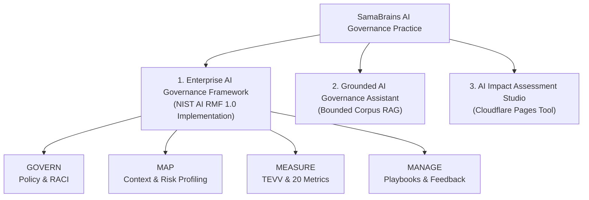

# SamaBrains AI Governance & Risk Solutions

[](https://www.nist.gov/itl/ai-risk-management-framework)
[](https://www.iso.org/standard/81230.html)
[]()
[](https://samabrains.com/)

> **Audit-ready AI governance frameworks, quantitative TEVV evaluations, and grounded assistants over bounded corpora.**  
> Built at and for **[SamaBrains](https://samabrains.com/)**, an independent AI governance, security, and responsible-AI practice led by **Robert Ssebambulidde**.

---

## Featured Portfolio Projects



---

### Project 1: Enterprise AI Governance Framework & TEVV (FinAssist AI)
> **Full Operational Case Study:** [`docs/README.md`](docs/README.md)  
> **Domain:** Financial Services / Tier-1 Enterprise Generative AI Assistant  
> **Standards:** NIST AI 100-1 (NIST AI RMF 1.0), ISO/IEC 42001, EU AI Act

Most enterprise AI ethics efforts stall at abstract statements. This project is a **production-grade, audit-ready operational governance framework** developed for a high-risk commercial banking assistant (**FinAssist AI**), spanning all four NIST AI RMF core functions:

```
docs/
├── 01-govern/
│   ├── AI-Governance-Policy.md             <- Enterprise policy & oversight gates
│   ├── AI-Roles-Matrix.md                  <- 3-tier RACI matrix & veto authority
│   ├── AI-System-Inventory.csv             <- Model catalog & risk tier classification
│   └── AI-Impact-Assessment-Template.md    <- Pre-deployment rights & harm assessment
├── 02-map/
│   ├── MAP-AI-System-Context-Report.md     <- Technical boundaries & 13 risk profiles (R-01..R-13)
│   ├── MAP-Stakeholder-Analysis.md         <- Impacted populations & whistleblower channels
│   └── MAP-Risk-Benefit-Matrix.csv         <- Quantitative risk vs. utility scoring
├── 03-measure/
│   ├── MEASURE-TEVV-Metrics-Framework.md   <- Independent testing & validation protocols
│   ├── MEASURE-Bias-Testing-Methodology.md <- Statistical demographic parity & disparate impact testing
│   └── MEASURE-Metrics-Tracker.csv         <- 20 operational metrics with breach thresholds
├── 04-manage/
│   ├── MANAGE-Risk-Response-Plan.md        <- Mitigation actions across all 13 MANAGE subcategories
│   ├── MANAGE-Incident-Response-Playbook.md<- SEV-1 to SEV-4 classification & 15-min containment SLAs
│   ├── MANAGE-Continuous-Improvement-Log.csv<- Post-incident & feedback closed-loop tracking
│   └── AI-Incident-Log.md                  <- Standardized incident reporting register
└── 00-references/
    ├── NIST-AI-RMF-Learning-Guide.md       <- 40+ page breakdown of NIST AI 100-1
    ├── NIST-AI-RMF-Playbook-Study-Notes.md <- Study notes across 72 NIST subcategories
    └── NIST.AI.100-1.pdf / Playbook.pdf    <- Primary standard publications
```

[Explore the full FinAssist AI Governance Framework →](docs/README.md)

---

### Project 2: Grounded AI Governance Knowledge Base & Assistant
> **Case Study Write-up:** [`solutions/ai-governance-kb-assistant/`](solutions/ai-governance-kb-assistant/)  
> **Live Demo:** [Ask SamaBrains](https://samabrains.com/ask/)

A grounded retrieval-augmented AI assistant designed to deliver **instant, cited answers** over a strictly bounded corpus of official AI governance laws and standards (NIST AI RMF, Uganda Data Protection and Privacy Act, ISO/IEC 42001) rather than an ungrounded general-purpose chatbot.

* **Key Capabilities:**
  * Strict grounding with named document and URL citations.
  * Dual-door architecture serving staff internal lookups (Ctrl+K) and public client inquiries (`/ask/`).
  * Continuous indexing of emerging regulatory texts and practice guidance.

[Read the Knowledge Base Case Study →](solutions/ai-governance-kb-assistant/)

---

### Project 3: Interactive NIST AI RMF Governance Hub (Cloudflare Pages)
> **Live Web Application:** [https://ai-impact-assessment-20y.pages.dev](https://ai-impact-assessment-20y.pages.dev)  
> **Source Directory:** [`tools/ai-impact-assessment/`](tools/ai-impact-assessment/)  
> **Deployment:** Cloudflare Pages (Turnkey static edge application)  
> **Standards Exclusively:** NIST AI Risk Management Framework 1.0 (NIST AI RMF — GOVERN · MAP · MEASURE · MANAGE)

A dynamic, audit-ready operational suite uniting four core governance modules into a single synchronized interface:

1. **AI System Inventory & Registry (GOVERN 1.6):** Real-time searchable registry, KPI cards, bidirectional CSV sync with repository inventory, and one-click assessment launches.
2. **AI Roles & Responsibilities Matrix (GOVERN 2.1 · 2.2 · 2.3 · 3.2):** Interactive 28-activity RACI lifecycle matrix, 18-role catalog with explicit Veto authorities, Human-AI Oversight Configurations (HITL/HOTL/HIC), and Workforce Training Tracker.
3. **AI Governance Policy & Deployment Gatekeeper (GOVERN 1.1–1.7 · 4.1 · 6.1–6.2):** Live 4-tier deployment gate validator (Zero Unmitigated Critical Risks, Legal Sign-off, Independent TEVV, Veto Approvals), 8 Trustworthy AI Principles audit, 9 mandatory lifecycle artifacts tracker, decommissioning triggers, third-party foundation model screener, risk waiver register, and executive attestation PDF exporter.
4. **AI Impact Assessment Studio (GOVERN 4.2 · MAP 3.1 · MANAGE 1.1):** 10-part assessment wizard with real-time Likelihood × Impact calculator, FinAssist AI preloads, executive white-paper PDF export, Markdown download, and JSON state persistence.

[Explore the NIST AI RMF Governance Hub Guide →](tools/ai-impact-assessment/README.md)

---

## Summary of Core Governance Deliverables

| Pillar | Key Artifacts | What It Delivers |
|---|---|---|
| **GOVERN** | [Policy](docs/01-govern/AI-Governance-Policy.md) · [Roles Matrix](docs/01-govern/AI-Roles-Matrix.md) · [System Inventory](docs/01-govern/AI-System-Inventory.csv) | Board-level accountability, clear RACI definitions, independent veto powers, and complete model registration. |
| **MAP** | [Context Report](docs/02-map/MAP-AI-System-Context-Report.md) · [Stakeholder Analysis](docs/02-map/MAP-Stakeholder-Analysis.md) · [Risk-Benefit Matrix](docs/02-map/MAP-Risk-Benefit-Matrix.csv) | Comprehensive categorization of the AI system, 13 profiled risks (R-01 to R-13), and disproportionate impact analysis on vulnerable groups. |
| **MEASURE** | [TEVV Framework](docs/03-measure/MEASURE-TEVV-Metrics-Framework.md) · [Bias Testing](docs/03-measure/MEASURE-Bias-Testing-Methodology.md) · [Metrics Tracker](docs/03-measure/MEASURE-Metrics-Tracker.csv) | Independent TEVV testing regimen tracking 20 quantitative metrics (hallucination rate, prompt injection bypass, latency, demographic parity). |
| **MANAGE** | [Risk Response Plan](docs/04-manage/MANAGE-Risk-Response-Plan.md) · [Incident Playbook](docs/04-manage/MANAGE-Incident-Response-Playbook.md) · [CI Log](docs/04-manage/MANAGE-Continuous-Improvement-Log.csv) | Automated circuit breakers, SEV-1 to SEV-4 incident escalation, emergency kill-switches, and continuous retraining feedback loops. |

---

## Operationalization & AI GRC Integration

This repository's deliverables are structured for straightforward integration into modern AI GRC and observability platforms:

* **[VerifyWise.ai](https://verifywise.ai/):** Open-source AI GRC platform native to NIST AI RMF. Deliverables map directly into VerifyWise's Model Inventory, Risk Register, and Incident Logging modules.
* **Credo AI / Holistic AI / Vanta AI:** Controls, roles, and impact assessments can be ingested as compliance evidence items for ISO/IEC 42001 certification audits.
* **LLM Observability (Langfuse / Phoenix / Arize):** Production telemetry streams real-time data into the 20 metrics defined in [`MEASURE-Metrics-Tracker.csv`](docs/03-measure/MEASURE-Metrics-Tracker.csv).

---

## Foundational Reference Guides

Included in this repository are comprehensive reference and study materials:

* [NIST AI RMF Learning Guide](docs/00-references/NIST-AI-RMF-Learning-Guide.md) — 40+ page breakdown of the NIST AI 100-1 framework.
* [NIST AI RMF Playbook Study Notes](docs/00-references/NIST-AI-RMF-Playbook-Study-Notes.md) — Line-by-line notes on all 72 NIST subcategories.
* [AI Risk Taxonomy Guide](docs/00-references/ai-risk-guide.md) — Categorized directory of AI harms, failure modes, and threat vectors.

---

## Legal Disclaimer

*The contents of this repository are provided for educational, governance architecture, and compliance demonstration purposes. They do not constitute formal legal counsel. For regulatory filings, engage certified legal counsel and accredited conformity assessment bodies.*

---

## Author & Practice

**Robert Ssebambulidde**  
Founder & Practice Lead, **[SamaBrains](https://samabrains.com/)**  
*AI Governance · AI Security · Responsible AI*  
- **Website:** [samabrains.com](https://samabrains.com/)  
- **Assistant:** [samabrains.com/ask/](https://samabrains.com/ask/)  
- **GitHub:** [@rssebambulidde](https://github.com/rssebambulidde)
