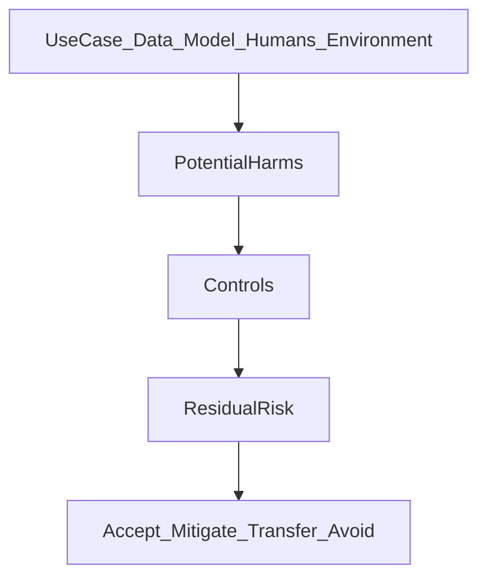
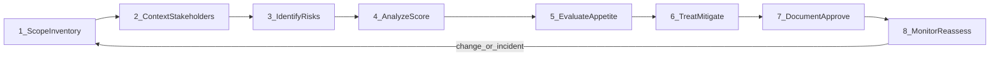

# AI Risk: Framing, Assessment, and Risk Types

A SamaBrains educational reference for understanding AI risk, how to frame it, how to assess it, and how common risk types show up in practice.

**Audience:** practitioners, reviewers, product owners, and teams preparing AI governance reviews or training.

**Disclaimer:** This document is educational. It is **not legal advice** and is not a substitute for official framework texts, regulatory guidance, or counsel. Framework names (NIST AI RMF, EU AI Act, ISO/IEC 42001) are used as orientation only.

---

## Table of contents

1. [What is AI risk?](#1-what-is-ai-risk)
2. [Framing of AI risk](#2-framing-of-ai-risk)
3. [AI risk assessment process](#3-ai-risk-assessment-process)
4. [AI risk types and examples](#4-ai-risk-types-and-examples)
5. [How it fits together](#5-how-it-fits-together)
6. [One-page risk register fields](#6-one-page-risk-register-fields)
7. [Further reading](#7-further-reading)

---

## 1. What is AI risk?

**AI risk** is the chance that an AI system causes **harm, loss, or unintended outcomes** — to people, organizations, or society — across its lifecycle: design, data, training or procurement, deployment, monitoring, update, and retirement.

A practical working definition:

> **AI risk = likelihood × severity of adverse outcomes** from how an AI system is built, used, fails, or is misused — including who is affected and whether controls reduce that risk to an acceptable level.

AI risk is broader than “the model gave a wrong answer.” It includes:

| Dimension | What it covers |
| --- | --- |
| **Technical** | Hallucinations, bias, drift, brittle performance, unsafe outputs |
| **Security** | Prompt injection, data poisoning, model theft, unsafe tool use |
| **Privacy** | Personal data in prompts, logs, training sets, or retrieval corpora |
| **Process / governance** | No owner, no approval, shadow AI, missing audit trail |
| **Legal / compliance** | Discrimination, sector rules, privacy law, contractual limits |
| **Operational / business** | Wrong decisions at scale, outages, over-reliance, vendor lock-in |
| **Reputational / societal** | Loss of trust, systemic unfairness, harmful content at scale |

### What AI risk is not

- Not only a security problem (though security is part of it)
- Not only a model-quality problem (process and use context matter as much)
- Not a one-time checklist at launch (risk changes when data, users, models, or law change)
- Not the same as “AI is always high risk” — risk depends on **use case, stakes, and controls**

### Lifecycle view

Risk can appear at every stage:

```text
Purpose & design → Data & features → Model / vendor → Integration & UX
        → Human oversight → Deployment → Monitoring → Change / retirement
```

A system that is acceptable for internal brainstorming may be unacceptable for automated hiring, medical triage, or credit decisions — same underlying technology, different risk profile.

---

## 2. Framing of AI risk

**Framing** means deciding *how* you look at risk before you score anything. Poor framing produces false comfort (missed harms) or noise (endless generic risks). Good framing answers four questions first:

| Frame | Question | Example |
| --- | --- | --- |
| **Context** | What is the use case and domain? | Hiring screener vs. marketing copy assistant |
| **Stakeholders** | Who can be harmed or affected? | Candidates, customers, patients, employees, public |
| **Impact** | What kinds of harm matter? | Rights, safety, money, privacy, reputation, compliance |
| **Lifecycle** | Where can risk emerge? | Training data, model behavior, human oversight, vendor |

### Framing diagram



### Common industry frames

Organizations usually combine more than one frame:

#### NIST AI Risk Management Framework (AI RMF)

Four functions that structure governance work:

| Function | Role in risk work |
| --- | --- |
| **Govern** | Policies, roles, culture, accountability |
| **Map** | Context, stakeholders, intended use, foreseeable misuse |
| **Measure** | Identify, analyze, and track risks and impacts |
| **Manage** | Prioritize, treat, monitor, and improve |

NIST framing emphasizes that risk management is continuous and organization-wide, not a single model test.

#### EU AI Act–style risk tiers (by use)

Risk is often classified by **what the system is used for**, not only by model size:

| Tier (conceptual) | Idea | Illustrative examples |
| --- | --- | --- |
| **Unacceptable** | Uses society generally prohibits | Manipulative systems that exploit vulnerabilities in prohibited ways; social scoring of the kind prohibited under applicable law |
| **High** | Significant impact on rights or safety; heavier duties | Biometrics in sensitive contexts; employment screening; credit scoring; access to essential services (where classified as high-risk under applicable rules) |
| **Limited** | Transparency / disclosure duties often dominate | Chatbots that should disclose they are AI |
| **Minimal / low** | Lighter obligations; still good practice to manage | Many internal productivity aids with low stakes |

Exact legal classification depends on jurisdiction and official texts. Use this as a **design orientation**, then verify against current law.

#### ISO/IEC 42001 (AI management system)

ISO 42001 frames AI risk inside a management system: leadership, planning, support, operation, performance evaluation, and continual improvement. Risk assessment and treatment sit alongside policies, roles, competence, and documented information — not as a standalone spreadsheet.

#### Practical harm categories

When framing impacts, it helps to ask which of these are in play:

- **Safety** — physical or severe psychological harm
- **Rights and fairness** — discrimination, due process, unequal treatment
- **Privacy and confidentiality** — personal data, secrets, IP
- **Financial and operational** — loss, fraud, downtime, bad automation
- **Trust and reputation** — public or customer confidence
- **Compliance** — regulatory, contractual, or policy breach

### Framing principles

1. **Start from the decision and the person affected**, not from the model brand.
2. Include **intended use** and **reasonably foreseeable misuse**.
3. Separate **inherent risk** (before controls) from **residual risk** (after controls).
4. Prefer **use-case risk** over “this vendor is high risk” alone.
5. Revisit framing when users, data, autonomy, or deployment change.

---

## 3. AI risk assessment process

An AI risk assessment turns framing into a documented judgment: what can go wrong, how bad it could be, what you will do about it, and who owns the residual risk.

### Process overview



### Step 1 — Scope and inventory

Capture what you are assessing:

- System / use case name and purpose
- Owner and business sponsor
- Data sources (including personal or sensitive data)
- Model(s), vendors, and integrations / tools
- Users, environments (dev / prod), and autonomy level (advisory vs. automated action)
- Dependencies (APIs, retrieval indexes, plugins)

**Output:** a clear scope boundary so the assessment is about one coherent use case.

### Step 2 — Context and stakeholder mapping

Document:

- Who uses the system and for what decisions
- Who is affected (including people who never “use” it but are scored or described by it)
- Sector and regulatory hooks (employment, health, finance, consumer, privacy)
- Existing policies, contracts, and risk appetite statements

**Output:** a context brief that guides which harms matter most.

### Step 3 — Identify risks and threats

Enumerate failure modes and misuse paths. Cover at least:

- Wrong or unreliable outputs
- Biased or discriminatory outcomes
- Privacy and confidentiality leaks
- Security and adversarial abuse
- Over-reliance and weak human oversight
- Vendor and supply-chain failure
- Drift after launch; silent degradation
- Governance gaps (shadow use, no logs, no escalation)

Techniques: workshops, threat modeling, red-team prompts, historical incidents, vendor questionnaires, and review of similar use cases.

**Output:** a risk list linked to the use case (not a generic AI scare list).

### Step 4 — Analyze and score

For each risk, estimate:

| Factor | Meaning |
| --- | --- |
| **Likelihood** | How plausible is the adverse outcome in this context? |
| **Impact** | How severe is harm if it occurs (rights, safety, money, trust, compliance)? |
| **Scale** | How many people or transactions could be affected? |
| **Detectability** | Would you notice quickly? |
| **Reversibility** | Can harm be undone? |

#### Example 1–5 scales

**Likelihood**

| Score | Label | Guidance |
| --- | --- | --- |
| 1 | Rare | Unlikely under normal and stressed conditions |
| 2 | Unlikely | Possible but not expected in routine operation |
| 3 | Possible | Could occur periodically without strong controls |
| 4 | Likely | Expected without mitigation |
| 5 | Almost certain | Observed or highly expected |

**Impact**

| Score | Label | Guidance |
| --- | --- | --- |
| 1 | Negligible | Minor inconvenience; easy correction |
| 2 | Minor | Limited individual or operational effect |
| 3 | Moderate | Meaningful harm, complaint, or rework |
| 4 | Major | Serious rights, financial, safety, or compliance impact |
| 5 | Severe | Irreversible harm, large-scale damage, or critical breach |

**Risk score (simple):** `Likelihood × Impact` (range 1–25). Organizations may use matrices, qualitative bands (Low / Medium / High / Critical), or more formal methods. Consistency matters more than the exact formula.

#### Inherent vs residual risk

| Term | Meaning |
| --- | --- |
| **Inherent risk** | Risk level **before** applying (or assuming) controls |
| **Residual risk** | Risk level **after** planned or existing controls |

Always record both. Approvals should be about residual risk, not hope.

### Step 5 — Evaluate against appetite

Compare residual risk to organizational thresholds:

- Proceed as designed
- Proceed only with additional controls or restricted use
- Transfer (e.g., insurance / contractual allocation — limited for AI harms)
- Avoid / reject the use case

High-impact automated decisions usually need stronger human oversight and higher approval authority than low-stakes drafting tools.

### Step 6 — Treat and mitigate

Select controls proportional to residual risk. Examples:

| Control type | Examples |
| --- | --- |
| **Preventive** | Access control, data minimization, approved-tool policy, least-privilege tools |
| **Detective** | Logging, eval suites, drift monitors, abuse detection, user feedback |
| **Corrective** | Rollback, kill switch, incident response, human override |
| **Directive** | Policies, training, role definition, approval gates |
| **Assurance** | Bias/fairness tests, red teaming, vendor due diligence, audits |

Map each material risk to at least one owner and one control or conscious acceptance.

### Step 7 — Document and approve

Produce a durable record:

- Risk register entries
- Scoring rationale and assumptions
- Control plan and evidence links
- Sign-off by system owner and required reviewers (risk, legal, security, privacy, as applicable)
- Link to frameworks/controls your organization tracks (e.g., NIST categories, ISO clauses)

### Step 8 — Monitor and reassess

Triggers for re-assessment:

- Model or prompt change
- New data source or new user population
- New automation (e.g., tool calling that spends money or changes records)
- Incidents, complaints, or near misses
- Regulatory or policy change
- Scheduled review cadence (e.g., quarterly for high residual risk)

**Output:** living assessment, not a one-off PDF.

### Lightweight summary flow

```text
Register use case → Identify harms → Score risk → Choose controls
→ Approve → Deploy with monitoring → Review on change or incident
```

---

## 4. AI risk types and examples

### Taxonomy of common AI risk types

| Risk type | Meaning | Examples |
| --- | --- | --- |
| **Performance / reliability** | Wrong, unstable, or degraded outputs | Hallucinated citations; recommendation quality collapse after an update |
| **Bias and discrimination** | Unequal or unfair outcomes across groups | Resume screener disadvantaging protected groups |
| **Privacy and data protection** | Unauthorized exposure or misuse of personal data | Customer chats used for training without a lawful basis; PII in prompt logs |
| **Security / adversarial** | Attacks or unsafe inputs | Prompt injection; training-data poisoning; model extraction |
| **Safety** | Harm to people or environment | Unsafe medical advice acted on; robotics misclassification |
| **Misinformation / content harm** | False, toxic, or harmful content | Deepfakes; chatbot spreading false health claims |
| **Misuse / malicious use** | Abuse of capabilities | Generating phishing copy; social-engineering scripts |
| **Transparency / explainability** | Users cannot understand or challenge decisions | Loan denial with no usable reason |
| **Accountability / governance** | No clear owner, trail, or escalation | Shadow GenAI tools with no approval or logging |
| **Vendor / third-party** | Dependency on external AI providers | Outage; unclear data residency; provider training on customer inputs |
| **Operational / business** | Disruption or costly automation errors | Wrong mass updates; over-reliance without fallback |
| **Legal and compliance** | Breach of law, regulation, or contract | Non-compliant automated hiring; privacy-law gaps |
| **Reputational** | Loss of trust | Public bias incident; leaked transcripts |
| **IP / confidentiality** | Leak of secrets or IP issues | Source code pasted into a public LLM; disputed training content |
| **Socioeconomic / societal** | Broader systemic effects | Displacement without transition planning; concentration of power |

Many real incidents sit in **more than one** row (for example: biased hiring is bias + legal + reputational + accountability).

### Scenario examples

#### Scenario A — HR screening assistant

**Use case:** LLM ranks applicants and drafts shortlist recommendations.

| Element | Detail |
| --- | --- |
| **Primary risk types** | Bias/discrimination, transparency, legal/compliance, accountability |
| **Why it matters** | Affects livelihood and legal rights; errors scale across candidates |
| **Example controls** | Human review of shortlists; documented criteria; bias testing; adverse-action process; audit logs; limited automation (recommend, do not auto-reject) |

#### Scenario B — Customer support LLM with CRM tools

**Use case:** Chatbot retrieves customer records and can issue refunds or change accounts.

| Element | Detail |
| --- | --- |
| **Primary risk types** | Privacy, security (prompt injection), operational, performance |
| **Why it matters** | Tool use turns text errors into real-world actions and data exposure |
| **Example controls** | Least-privilege tools; confirmation for money-moving actions; PII redaction; grounding/retrieval limits; injection defenses; human escalation |

#### Scenario C — Shadow GenAI in a business team

**Use case:** Staff paste internal documents into consumer chatbots without approval.

| Element | Detail |
| --- | --- |
| **Primary risk types** | Accountability/governance, IP/confidentiality, vendor/privacy, reputational |
| **Why it matters** | No inventory, no contracts, no monitoring — risk is invisible until an incident |
| **Example controls** | Discovery and inventory; approved tools; DLP; policy and training; easy sanctioned alternatives |

#### Scenario D — Credit or eligibility scoring

**Use case:** Model influences loan, insurance, or service eligibility.

| Element | Detail |
| --- | --- |
| **Primary risk types** | Bias, transparency, legal/compliance, performance |
| **Why it matters** | High-stakes individual decisions; often regulated |
| **Example controls** | Fairness metrics; explainability/adverse notices; validation and monitoring; human appeal path; change control |

#### Scenario E — Marketing / content generation

**Use case:** Generative model drafts public campaign copy and images.

| Element | Detail |
| --- | --- |
| **Primary risk types** | Misinformation/content harm, IP, reputational, performance |
| **Why it matters** | Brand and legal exposure if false or infringing content is published |
| **Example controls** | Human editorial review; brand and claims policy; source checks; IP guidelines; publish gate |

#### Scenario F — Vendor model API for product feature

**Use case:** Product embeds a third-party model API for summarization inside a customer app.

| Element | Detail |
| --- | --- |
| **Primary risk types** | Vendor/third-party, privacy, security, operational, legal |
| **Why it matters** | Customer data and uptime depend on another party’s practices and failures |
| **Example controls** | Due diligence; DPA and data-use terms; residency requirements; eval harness; fallback; incident clauses; continuous vendor review |

---

## 5. How it fits together

```text
Framing (context, harm, stakeholders, lifecycle)
        ↓
Risk types (what can go wrong)
        ↓
Assessment process (identify → score → treat → monitor)
        ↓
Residual risk decision (accept / mitigate / transfer / avoid)
```

Use framing to stay grounded in the real use case. Use the taxonomy to avoid blind spots. Use the assessment process to turn judgment into accountable decisions. Reassess when the system or its world changes.

For SamaBrains-style reviews, a useful discipline is: **name the use case, name the affected people, name the top risks, name the controls, name the residual risk owner.** If any of those are missing, the assessment is incomplete.

---

## 6. One-page risk register fields

Minimum useful fields for an AI risk register entry:

| Field | Purpose |
| --- | --- |
| **System / use case** | What is being assessed |
| **Owner / sponsor** | Accountable person |
| **Description** | Short statement of the risk |
| **Risk type(s)** | From the taxonomy |
| **Stakeholders / affected parties** | Who can be harmed |
| **Inherent likelihood / impact / score** | Before controls |
| **Existing / planned controls** | What reduces the risk |
| **Residual likelihood / impact / score** | After controls |
| **Treatment decision** | Accept / mitigate / transfer / avoid |
| **Action owners and due dates** | Who does what by when |
| **Evidence links** | Tests, policies, tickets, approvals |
| **Approval** | Who signed off residual risk |
| **Review date / triggers** | When to reassess |
| **Status** | Open / monitoring / closed |

Optional but valuable: framework mapping (e.g., NIST function, ISO control reference), data classification, autonomy level, and related incident IDs.

---

## 7. Further reading

Official and primary sources (verify current versions):

- [NIST AI Risk Management Framework (AI RMF 1.0)](https://www.nist.gov/itl/ai-risk-management-framework)
- [EU Artificial Intelligence Act — official information](https://digital-strategy.ec.europa.eu/en/policies/regulatory-framework-ai)
- [ISO/IEC 42001 — AI management system](https://www.iso.org/standard/81230.html) (standard available via ISO / national bodies)

Related SamaBrains context: this guide lives in the [AI Governance](../README.md) solutions repo as an educational reference alongside grounded assistants and lab materials.

---

*Document version: 1.0 — educational reference for AI risk framing, assessment, and typology.*
