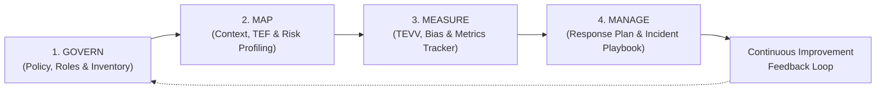

# 🏛️ NIST AI RMF 1.0 Implementation: FinAssist AI

> **Operational Governance, Risk Mapping, TEVV Metrics, and Incident Response for an Enterprise Financial Services LLM**  
> *Aligned with NIST AI 100-1 (NIST AI Risk Management Framework 1.0), ISO/IEC 42001 (Artificial Intelligence Management System), and Global Regulatory Guidance.*

---

## 📌 Executive Summary

This documentation repository contains the **complete, end-to-end operational governance implementation** for **FinAssist AI (SYS-FIN-001)**—a Tier-1 enterprise Generative AI assistant deployed by a commercial retail bank for customer financial inquiry assistance, account navigation, and financial product guidance.

Rather than remaining at the level of abstract principles, this repository details line-item technical and organizational controls, quantitative metric thresholds, independent TEVV (Test, Evaluation, Verification, and Validation) protocols, and emergency containment playbooks.

---

## 📁 Repository Directory & Deliverables Index

All files in this directory are interlinked with relative markdown links, making them fully browsable on GitHub, local markdown viewers, or web doc systems.

### 🏛️ 1. GOVERN Function — Institutional Accountability & Culture
*Cultivating a culture of risk management, clear accountability, and structured pre-deployment gates.*

| Artifact | Format | Description | NIST AI RMF Core |
|---|---|---|---|
| [AI-Governance-Policy.md](./01-govern/AI-Governance-Policy.md) | Markdown | Comprehensive enterprise policy establishing AI governance principles, compliance requirements, third-party LLM standards, and mandatory oversight gates. | GOVERN 1.1–1.3, 2.1–2.3 |
| [AI-Roles-Matrix.md](./01-govern/AI-Roles-Matrix.md) | Markdown | 3-tier RACI matrix across Board/C-Suite, AI Ethics Board, System Owner, TEVV Team Lead, SecOps, and Legal/Compliance. Identifies absolute veto holders. | GOVERN 2.1, 4.1 |
| [AI-System-Inventory.csv](./01-govern/AI-System-Inventory.csv) | CSV | Formal inventory registry tracking model class, risk tier, vendor (Anthropic/OpenAI/Cloudflare), hosting model, data classification, and lifecycle state. | GOVERN 3.1, 3.2 |
| [AI-Impact-Assessment-Template.md](./01-govern/AI-Impact-Assessment-Template.md) | Markdown | Mandatory 6-section pre-deployment questionnaire evaluating business need, rights impact, data privacy, failure modes, and human-in-the-loop controls. | GOVERN 1.2, MAP 1.1 |

---

### 🗺️ 2. MAP Function — Context, Risks & Stakeholder Impact
*Understanding context, categorizing system boundaries, and profiling specific AI harms.*

| Artifact | Format | Description | NIST AI RMF Core |
|---|---|---|---|
| [MAP-AI-System-Context-Report.md](./02-map/MAP-AI-System-Context-Report.md) | Markdown | Full technical and operational context report for FinAssist AI. Analyzes deployment environment, dependencies, potential harms, and detailed risk profiles (R-01 to R-13). | MAP 1.1–1.6, 2.1–2.4 |
| [MAP-Stakeholder-Analysis.md](./02-map/MAP-Stakeholder-Analysis.md) | Markdown | Systematic analysis of all impacted populations (retail customers, vulnerable borrowers, support staff, regulators), engagement mechanisms, and whistleblower channels. | MAP 3.1–3.5, 4.1 |
| [MAP-Risk-Benefit-Matrix.csv](./02-map/MAP-Risk-Benefit-Matrix.csv) | CSV | Structured matrix balancing operational benefits (wait times, accessibility) against specific risk categories with pre- and post-mitigation risk scores. | MAP 2.2, 5.1–5.2 |

---

### 📏 3. MEASURE Function — TEVV & Quantitative Evaluation
*Rigorous testing, evaluation, verification, and validation (TEVV) against measurable benchmarks.*

| Artifact | Format | Description | NIST AI RMF Core |
|---|---|---|---|
| [MEASURE-TEVV-Metrics-Framework.md](./03-measure/MEASURE-TEVV-Metrics-Framework.md) | Markdown | Formal testing protocols and governance for 20 operational metrics spanning trustworthiness, safety, security, fairness, latency, and drift. | MEASURE 1.1–1.4, 2.1–2.13 |
| [MEASURE-Bias-Testing-Methodology.md](./03-measure/MEASURE-Bias-Testing-Methodology.md) | Markdown | Explicit statistical testing methodologies across protected classes (age, gender, income, geographic location) including Disparate Impact Ratio and counterfactual fairness. | MEASURE 2.5, 2.11 |
| [MEASURE-Metrics-Tracker.csv](./03-measure/MEASURE-Metrics-Tracker.csv) | CSV | Quantitative tracker defining 20 line-item metrics (M-01 to M-20), target baselines, hard breach thresholds, evaluation cadences, and assigned owners. | MEASURE 2.1–2.13 |

---

### 🛡️ 4. MANAGE Function — Risk Response, Incident Playbook & Continuous Improvement
*Allocating risk resources, sustaining mitigations in production, containing incidents, and closing the learning loop.*

| Artifact | Format | Description | NIST AI RMF Core |
|---|---|---|---|
| [MANAGE-Risk-Response-Plan.md](./04-manage/MANAGE-Risk-Response-Plan.md) | Markdown | Actionable response strategies for all 13 MAP risks (R-01 to R-13) across 13 MANAGE subcategories (1.1–4.3), including metric breach triggers and emergency kill-switches. | MANAGE 1.1–4.3 |
| [MANAGE-Incident-Response-Playbook.md](./04-manage/MANAGE-Incident-Response-Playbook.md) | Markdown | Real-time incident management playbook: SEV-1 to SEV-4 classification, response SLAs, triage flowcharts, containment actions, regulatory disclosure timelines, and post-mortems. | MANAGE 3.1–3.3, 4.1 |
| [MANAGE-Continuous-Improvement-Log.csv](./04-manage/MANAGE-Continuous-Improvement-Log.csv) | CSV | Living log linking monitoring alerts, customer feedback, and post-incident reviews back to model retraining and guardrail updates. | MANAGE 4.2, 4.3 |
| [AI-Incident-Log.md](./04-manage/AI-Incident-Log.md) | Markdown | Standardized incident reporting register with root-cause analysis templates, regulatory notification checklists (GDPR/DPPA/Banking), and corrective action tracking. | MANAGE 3.2, 4.1 |

---

### 📚 5. Study Notes & Standards Reference Materials
*Foundational study materials and primary reference frameworks.*

| Artifact | Description |
|---|---|
| [NIST-AI-RMF-Learning-Guide.md](./00-references/NIST-AI-RMF-Learning-Guide.md) | Comprehensive study guide for the NIST AI 100-1 framework, its 7 Trustworthy AI characteristics, and organizational implementation strategies. |
| [NIST-AI-RMF-Playbook-Study-Notes.md](./00-references/NIST-AI-RMF-Playbook-Study-Notes.md) | Deep-dive notes extracted from the official 147-page NIST AI RMF Playbook covering all 72 subcategories. |
| [ai-risk-guide.md](./00-references/ai-risk-guide.md) | Quick-reference taxonomy of artificial intelligence risks, vulnerabilities, and mitigations. |
| [NIST.AI.100-1.pdf](./00-references/NIST.AI.100-1.pdf) | Official NIST AI RMF 1.0 publication (NIST AI 100-1). |
| [AI-RMF-Playbook.pdf](./00-references/AI-RMF-Playbook.pdf) | Official NIST AI RMF Playbook PDF. |
| [nist-ai-rmf-playbook.csv](./00-references/nist-ai-rmf-playbook.csv) / [.xlsx](./00-references/nist-ai-rmf-playbook.xlsx) | Structured data tables containing the full catalog of NIST AI RMF action items. |

---

## 🔗 Operationalization with AI GRC Platforms

This framework is built for immediate ingestion into modern AI Governance, Risk, and Compliance (GRC) tools:

* **[VerifyWise.ai](https://verifywise.ai/):** Maps directly to Model Inventory, NIST AI RMF Risk Register, Automated LLM Evals, and Incident Logging.
* **Credo AI / Holistic AI / Vanta / OneTrust AI:** Maps to System Cards, Risk Assessments, and Policy Compliance Evidence.
* **Observability (Langfuse / Arize Phoenix / OpenTelemetry):** Telemetry feeds metrics (M-01 to M-20) into the [MEASURE-Metrics-Tracker.csv](./03-measure/MEASURE-Metrics-Tracker.csv).
